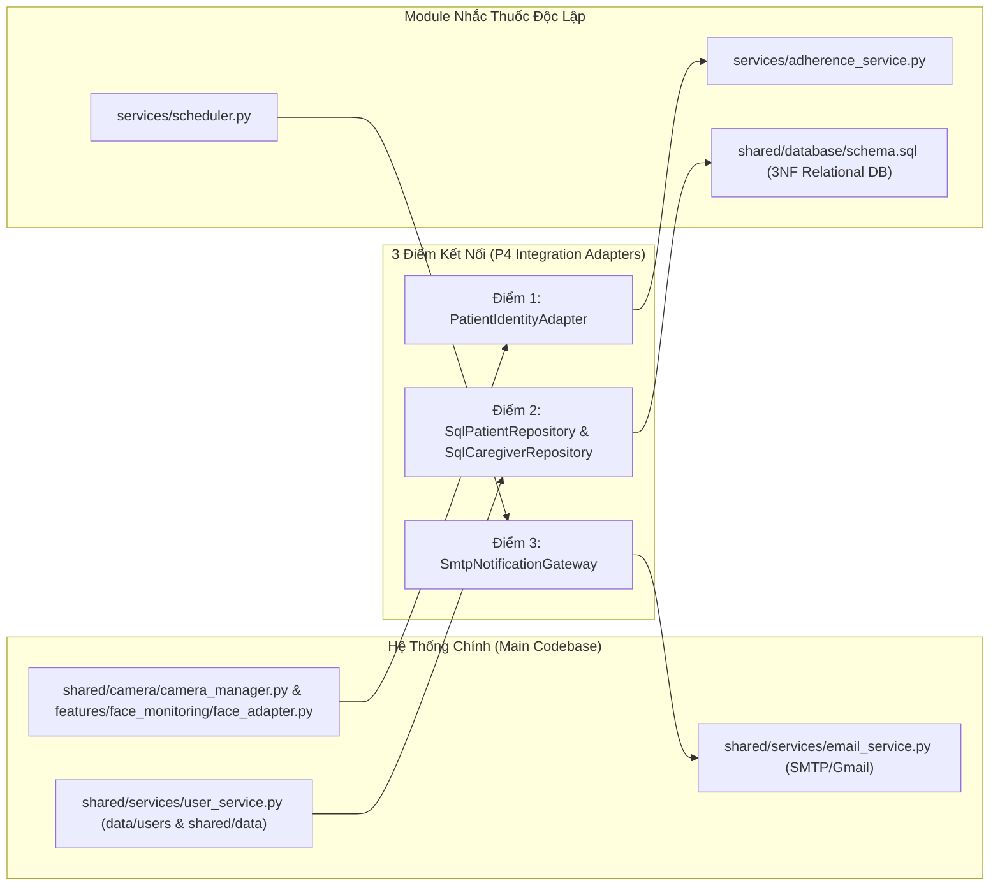

# Tài Liệu Hướng Dẫn Tích Hợp Module Nhắc Thuốc (P4 Integration Guide)

Tài liệu này xác định chính xác **3 điểm kết nối** giữa module độc lập `features/medication/adherence/` và hệ thống chính `AI_Rehabilitation_Safety_Assistant` khi bước vào giai đoạn tích hợp (P4).

Toàn bộ lõi nghiệp vụ, mô hình dữ liệu 3NF và logic bộ lập lịch (Scheduler) được giữ nguyên, chỉ thay thế hoặc bổ sung các adapter tương ứng.



---

## 1. Điểm Nối 1: Luồng Nhận Diện Bệnh Nhân Từ Camera (Patient Identity Stream)

### Hiện trạng hệ thống chính
- `features/face_monitoring/face_adapter.py` định kỳ nhận diện khuôn mặt và cung cấp:
  ```python
  face_info = face_adapter.get_latest_recognition()
  # Trả về: {"status": "recognized", "patient_id": "patient_001", "name": "...", "confidence": 0.95}
  ```
- `apps/desktop/dashboard.py` lắng nghe frame camera và gọi `face_adapter.get_latest_recognition()`.

### Cách kết nối vào module nhắc thuốc
Thay thế `MockPatientIdentityAdapter` bằng một adapter gắn trực tiếp vào callback nhận diện của `FaceAdapter`:

```python
from modules.medication_adherence.adapters.identity_adapter import PatientIdentityAdapter

class LiveCameraIdentityAdapter(PatientIdentityAdapter):
    """Lắng nghe sự kiện nhận diện từ FaceAdapter của hệ thống chính."""
    def on_face_frame_processed(self, face_info: dict) -> None:
        status = face_info.get("status")
        if status == "recognized":
            pid = face_info.get("patient_id")
            conf = face_info.get("confidence", 1.0)
            self.set_identity(patient_id=pid, source="camera_face_recognition", confidence=conf)
        elif status in ("unknown", "no_face"):
            # Không tự ý suy đoán danh tính khi góc nhìn bị khuất
            self.set_identity(patient_id=None, source="camera_no_face", confidence=0.0)
```

**Quy tắc an toàn**: Khi trạng thái nhận diện chuyển sang `None` hoặc sang bệnh nhân khác, `PatientIdentityAdapter` tự động kích hoạt callback xoá sạch bộ đệm hiển thị thuốc của bệnh nhân cũ nhằm chống rò rỉ dữ liệu trên thiết bị dùng chung (Anti-Cross-Contamination).

---

## 2. Điểm Nối 2: Ánh Xạ Hồ Sơ Bệnh Nhân & Người Chăm Sóc (Data Mapping)

### Hiện trạng hệ thống chính
- Hồ sơ người dùng lưu tại:
  - `data/users/{user_id}.json`
  - `shared/data/patients.json`
- Cấu trúc JSON hiện hữu:
  ```json
  {
    "user_id": "patient_001",
    "name": "tonghoanganh",
    "age": 70,
    "gender": "Nam",
    "caregiver": {
      "name": "Nguyen Van A",
      "relationship": "Con trai",
      "email": "caregiver@example.com",
      "phone": "0912345678"
    }
  }
  ```

### Cách kết nối vào module nhắc thuốc
Module nhắc thuốc yêu cầu CSDL 3NF tách biệt: `patients`, `caregivers`, `patient_caregivers`.
Viết migration một lần (one-time sync) chuyển đổi dữ liệu JSON hiện có sang các bảng 3NF:
1. Đọc từng file `{user_id}.json` qua `UserService.get_all_users()`.
2. Tạo bản ghi `users` và `patients` (giữ nguyên `patient_id` để khớp với mô hình nhận diện khuôn mặt).
3. Tạo bản ghi `caregivers` cho người chăm sóc tương ứng.
4. Tạo bản ghi `patient_caregivers` thiết lập:
   - `is_primary = 1`
   - `notification_priority = 1`
   - `is_active = 1`
   - `consent_status = 'GRANTED'`
   - `valid_from = created_at`
   - `valid_to = '2099-12-31'`
   - `email_verified = 1` nếu email hợp lệ theo `UserService.validate_email`.

---

## 3. Điểm Nối 3: Cổng Gửi Thông Báo Người Nhà (Notification Gateway)

### Hiện trạng hệ thống chính
- `shared/services/email_service.py` sở hữu `EmailService`:
  - Có cấu hình SMTP qua biến môi trường (`EMAIL_HOST`, `EMAIL_PORT`, `EMAIL_USERNAME`, `EMAIL_PASSWORD`).
  - Hỗ trợ gửi email báo quá hạn liều thuốc kèm mã lần nhắc:
    `EmailService.send_medication_overdue(recipient_email, patient_name, due_time, event_id)`.
  - Có sẵn cơ chế chống gửi email trong môi trường test (`network_blocked()`).

### Cách kết nối vào module nhắc thuốc
Tạo một adapter kế thừa `INotificationGateway` bọc `EmailService` của hệ thống chính:

```python
from modules.medication_adherence.domain.contracts import INotificationGateway
from modules.medication_adherence.domain.models import NotificationDelivery, Alert, Patient, DeliveryStatus
from services.email_service import EmailService

class MainSystemEmailNotificationGateway(INotificationGateway):
    """Adapter uỷ quyền tác vụ gửi email cho EmailService hiện có của hệ thống chính."""
    def __init__(self, email_service: EmailService) -> None:
        self.email_service = email_service

    def send_alert(self, delivery: NotificationDelivery, alert: Alert, patient: Patient) -> NotificationDelivery:
        result = self.email_service.send_medication_overdue(
            recipient_email=delivery.recipient_snapshot,
            patient_name=patient.full_name,
            due_time=delivery.last_attempt_at_utc,
            event_id=alert.alert_id,
        )
        if result.success:
            delivery.status = DeliveryStatus.DELIVERED
            delivery.error_message = ""
        else:
            delivery.status = DeliveryStatus.FAILED
            delivery.error_message = result.message
        return delivery
```

---

## 4. Tóm Tắt Lộ Trình P4 Khi Bắt Đầu Tích Hợp

1. **Bước 1**: Nhúng `features/medication/adherence/database/schema.sql` vào thư mục dữ liệu `WRITABLE_ROOT` (`medication_adherence.sqlite3`).
2. **Bước 2**: Chạy migration đồng bộ các hồ sơ từ `data/users/` vào bảng 3NF.
3. **Bước 3**: Khởi tạo `AdherenceScheduler` chạy trong background thread của `DashboardWindow`.
4. **Bước 4**: Thêm tab `Nhắc Uống Thuốc (Adherence)` vào `DashboardWindow` nhúng `ElderlyWidget` và `CaregiverWidget`.
5. **Bước 5**: Nối `LiveCameraIdentityAdapter` vào luồng `CameraManager` frame processor.
